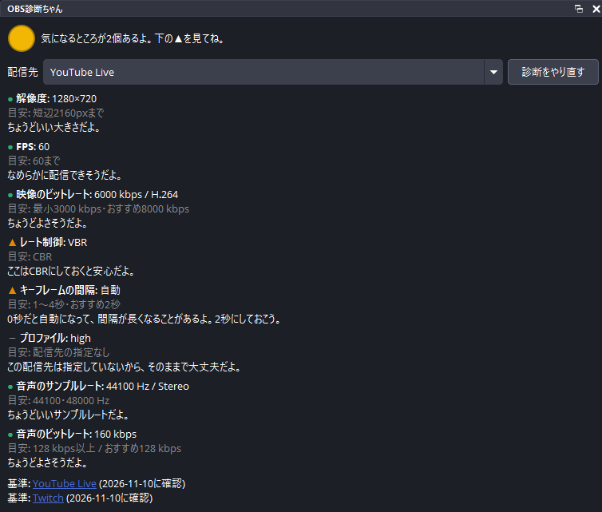

# OBS診断ちゃん / OBS Shindan-chan

OBS Studio の配信設定を、YouTube Live と Twitch の推奨値と比べて診断するドックのプラグインです。OBS の中で動いている設定を直接読み、結果を緑・黄・赤のランプと話し言葉のコメントで示します。設定を変えたあとも、OBS を離れずに診断をやり直せます。

Windows 向けのデスクトップアプリ「[OBS診断ちゃん](https://github.com/AllegroMoltoV/obs-shindan-chan)」の診断を、OBS のドックへ移したものです。アプリのネットワークの診断は、このプラグインに含みません。

このプラグインは OBS Project の公式のものではなく、OBS Project とは関係ありません。YouTube と Twitch の名前は、診断の基準にした配信先を示すためにだけ使っています。



## 主な機能

- 解像度・FPS・映像のビットレート・レート制御・キーフレームの間隔・プロファイル・音声のサンプルレート・音声のビットレートの 8 項目を診断します。
- 配信先を YouTube Live と Twitch で切り替えられます。起動時とプロファイルの切替え時には、OBS の配信先の設定から自動で選びます。判別できないときは YouTube Live を選びます。
- 警告の数でランプの色が変わります。0 件で緑、1 件と 2 件で黄、3 件以上で赤です。
- OBS が配信先に合わせて値を変える項目では、設定の値と配信で使われる値の両方を表示します。
- 次の時点で自動で診断をやり直します。OBS の読み込みの完了、プロファイルの切替え、設定の画面の「適用」と画面を閉じたとき、配信の開始の直前、ドックの表示です。「診断をやり直す」のボタンでも診断できます。
- 表示は日本語と英語に対応しています。OBS の言語の設定にしたがいます。

## 診断の項目と基準

基準の数値は、2026-11-10 に各社の公式の案内で確かめた値です。数値は [data/rules.ini](data/rules.ini) にあり、ドックの下に案内へのリンクと確認日を表示します。

| 項目 | YouTube Live | Twitch |
| --- | --- | --- |
| 解像度 | 短辺 2160px まで | 短辺 1080px まで |
| FPS | 60 まで | 25・30・50・60 |
| 映像のビットレート | 解像度・FPS・コーデックごとの最小を下回ると警告。推奨は目安として表示 | 解像度・FPS ごとの推奨を目安として表示。6,000kbps を超えると警告 |
| レート制御 | CBR | CBR |
| キーフレームの間隔 | 1 秒から 4 秒。推奨は 2 秒 | 2 秒 |
| プロファイル | 指定なし | H.264 の Main か High |
| 音声のサンプルレート | 44.1kHz か 48kHz。サラウンドは 48kHz | 指定なし |
| 音声のビットレート | ステレオは 128kbps 以上、サラウンドは 384kbps 以上 | 160kbps まで。推奨は 96kbps。ステレオかモノラル |

基本モードでは、レート制御・キーフレームの間隔・プロファイルを OBS が配信先に合わせて設定するため、判定しません。Twitch の Enhanced Broadcasting を有効にしているときは、映像の設定を Twitch が決めるため、映像の項目を判定しません。

YouTube の案内には映像のビットレートの上限がないため、上限を超えたことによる警告は出しません。解像度と FPS の組み合わせが表にないときと、エンコーダーのコーデックを判別できないときは、判定せずに配信先の案内で確かめるよう表示します。

参照した案内は次のとおりです。

- YouTube: https://support.google.com/youtube/answer/2853702
- Twitch: https://help.twitch.tv/s/article/broadcasting-guidelines?language=en_US

## 対応環境と配布

対象の OBS Studio のバージョンは 33.0.1 です。GitHub Actions で Windows・macOS・Linux のビルドと判定の単体テストを実行しています。

Windows の OBS Studio 33.0.1 では、作者がドックの使い心地を確かめました。あわせて、配信の前に組み立てた値と OBS が配信用のエンコーダーへ実際に適用した値が、基本モードと詳細モードの 10 通りの組合せで一致することを確かめています。詳細は [読み取りの自動検証の結果](docs/reports/2026-11-11-reader-verification.md) にあります。

| OS | 配布方法 |
| --- | --- |
| Windows x64 | ビルド済みの ZIP |
| macOS | 公開タグのソースからビルド |
| Linux | 公開タグのソースからビルド |

macOS と Linux の OBS 上での動作は確認していません。

## インストール

### Windows

1. [Releases](https://github.com/AllegroMoltoV/obs-shindan-chan-plugin/releases) から最新の Windows x64 の ZIP をダウンロードしてください。
2. OBS Studio を終了し、ZIP を展開してください。
3. エクスプローラーのアドレス欄に `%PROGRAMDATA%` を入力して開き、`obs-studio` フォルダー、`plugins` フォルダーの順に開いてください。フォルダーがない場合は、右クリックの「新規作成」から「フォルダー」を選び、同じ名前のフォルダーを作ってください。
4. ZIP の中の `obs-shindan-chan-plugin` フォルダーを、`plugins` フォルダーへコピーしてください。管理者の許可を求められた場合は、許可して続けてください。

```text
C:\ProgramData\obs-studio\plugins\
└─ obs-shindan-chan-plugin\
   ├─ obs-shindan-chan-plugin.dll
   └─ data\
      ├─ rules.ini
      └─ locale\
         ├─ en-US.ini
         └─ ja-JP.ini
```

5. OBS Studio を起動し、メニューの「ドック」から「OBS診断ちゃん」を選んでください。

`ProgramData` は隠しフォルダーです。アドレス欄にパスを入力すると、隠しフォルダーの表示の設定を変えずに開けます。

### macOS・Linux

ビルド済みのインストーラーは配布していません。後述の「ソースからのビルド」にしたがって、公開タグのソースからビルドしてください。

## 使い方

1. ドックの「配信先」で、配信する先を選んでください。
2. 8 項目の結果を確かめてください。▲ の付いた項目が警告です。各項目の下に、目安の値とコメントを表示します。
3. OBS の設定の画面で値を直し、「適用」を押すか画面を閉じてください。ドックの結果が更新されます。更新されないときは「診断をやり直す」を押してください。

音声のサンプルレートとチャンネルの変更は、OBS を再起動するまで反映されません。再起動の前は、ドックにその旨を表示します。

## 診断の対象と制約

配信の前の時点では、OBS は配信に使うエンコーダーの設定をまだ作っていません。このプラグインは、OBS のプロファイルの設定と `streamEncoder.json` から、OBS と同じ手順で配信に使われる値を組み立てます。配信先のサービスの推奨値の適用も、OBS の関数をそのまま使います。

Twitch の Enhanced Broadcasting を使う配信では、映像の設定を配信の開始時に Twitch のサーバーが決めます。このプラグインはその設定を配信の前に知ることができないため、映像の項目を判定しません。

このプラグインは外部へ通信しません。OS のコマンドも実行しません。ドックの下のリンクを押したときだけ、既定のブラウザーで各社の案内を開きます。

緑・黄・赤の判定は、各社の案内の数値と比べた目安です。配信の品質や配信先の受け入れを保証するものではありません。

## ソースからのビルド

Git と CMake 3.28 以上を用意してください。ビルド時に依存するファイルを取得するため、インターネットへの接続が必要です。依存する OBS のソースと Qt のバージョンは [buildspec.json](buildspec.json) で固定しています。

```sh
git clone https://github.com/AllegroMoltoV/obs-shindan-chan-plugin.git
cd obs-shindan-chan-plugin
```

### Windows

Visual Studio 2026 の C++ の開発環境と Windows SDK 10.0.26100 を用意してください。

```powershell
cmake --preset windows-x64 -DENABLE_POST_BUILD_INSTALL=OFF -DENABLE_TESTS=ON
cmake --build --preset windows-x64 --config RelWithDebInfo
ctest --test-dir build_x64 -C RelWithDebInfo --output-on-failure
cmake --install build_x64 --config RelWithDebInfo --prefix release/RelWithDebInfo
```

生成した `release/RelWithDebInfo/obs-shindan-chan-plugin` フォルダーを、前述のインストール先へコピーしてください。

### macOS

Xcode 26.5 と macOS SDK 26.5 を用意し、`xcode-select` でその Xcode を選んでください。

```sh
cmake --preset macos-ci -DENABLE_CCACHE=OFF -DCODESIGN_IDENTITY=- -DCODESIGN_TEAM=
cmake --build --preset macos-ci --config RelWithDebInfo
cmake --install build_macos --config RelWithDebInfo --prefix release/RelWithDebInfo
mkdir -p "$HOME/Library/Application Support/obs-studio/plugins"
cp -R release/RelWithDebInfo/obs-shindan-chan-plugin.plugin "$HOME/Library/Application Support/obs-studio/plugins/"
```

### Ubuntu 26.04 x86_64

この手順では、ビルドに必要なパッケージと公式の OBS Studio 33.0.1 をシステムへ導入します。

```sh
sudo apt-get update
sudo apt-get install -y zsh
zsh .github/scripts/build-ubuntu --target ubuntu-x86_64 --config RelWithDebInfo
sudo cmake --install build_x86_64 --config RelWithDebInfo --prefix /usr/local
```

## AI利用開示 / AI Disclosure

### 日本語

Anthropic Claude Code を、ソースコード、ビルドの設定、テスト、文書、ロゴを含むほぼすべての工程で使用しました。ロゴは Claude Code が作った 3 つの案から、作者が選びました。原本は [logo.svg](docs/images/logo.svg)、掲載用の画像は [logo.png](docs/images/logo.png) です。

作者本人は Windows 上の OBS Studio でユーザーテストを実施しました。ドックの画面の画像は、作者が撮影したスクリーンショットで、生成 AI を使用していません。コードの読解による厳密な人間のレビューは実施していません。

### English

Anthropic Claude Code was used for almost the entire development process, including source code, build configuration, tests, documentation, and the logo. The author chose the logo from three proposals made by Claude Code. The [SVG source](docs/images/logo.svg) and [PNG image](docs/images/logo.png) are included in the repository.

The author performed user testing in OBS Studio on Windows. The dock screenshot was taken by the author without generative AI. The author did not perform a rigorous human review of the source code.

## License

GPL-2.0 (same as OBS Studio)

## Author

AllegroMoltoV - [https://www.allegromoltov.jp](https://www.allegromoltov.jp)

## 更新情報

### v1.0.0

最初の版です。
